# Node + React + PostgreSQL Platform: DevOps Assessment

A simple React + Node.js + PostgreSQL app turned into a production-style platform using Docker Compose, Kubernetes (kind), NGINX Ingress, GitHub Actions CI/CD, Redis/BullMQ/OpenSearch, and a Prometheus/Grafana/Fluent Bit/Loki observability stack. Everything was built and tested on a single AWS EC2 Ubuntu instance.

| Item | Detail |
|---|---|
| Repository | `jubair2002/node-react-postgres-platform` |
| Platform | AWS EC2 (Ubuntu) m7i.XLarge (as local environment)|
| Cluster | kind (`my-cluster`), single control-plane node |
| Namespace | `dev` (app), `monitoring` (Prometheus/Grafana), Fluent Bit and Loki |
| Registry | Docker Hub (`jubair2002/assesment-backend`, `jubair2002/assesment-frontend`) |
| CI/CD | GitHub Actions with a self-hosted runner on the EC2 host |

## Repository layout

```
.
├── Dockerfile.backend
├── Dockerfile.frontend
├── .dockerignore
├── docker-compose.yml
├── k8s/                      # all Kubernetes manifests (namespace dev)
├── observability/            # Prometheus/Grafana, Fluent Bit, Loki config
├── .github/workflows/ci-cd.yml
├── docs/                     # screenshots (evidence)
└── README.md
```

---

## 1. Prerequisites and one-command startup

**Prerequisites:** Docker + Docker Compose v2, `kubectl`, `kind`, `helm`, Git.

### Docker Compose

```bash
cp .env.example .env        # set DB_PASSWORD etc. (never commit .env)
docker compose up -d --build
docker compose ps
```

Frontend: `http://<host>:8080`  |  Backend: `http://localhost:4000/api/health`

### Kubernetes (kind)

```bash
kind create cluster --name my-cluster
kubectl apply -f k8s/            # namespace first, then everything else
kubectl get all -n dev
```

Frontend NodePort: `http://<host>:30080`. Friendly hostname via Ingress: see section 3.

---

## 2. Task 1: Docker Compose

- Multi-stage Dockerfiles for the backend and the frontend keep the final images small.
- Compose runs `backend`, `frontend`, `postgres` (named volume, so data survives restarts), plus `redis`, `search` (OpenSearch) and `worker` added in Task 5.
- DB host, port, user, password, DB name and the API base URL are all environment variables. No secrets are hardcoded.
- The backend publishes only on `127.0.0.1:4000`, and Postgres on `127.0.0.1:5432`, so they are not exposed publicly.

**Evidence**

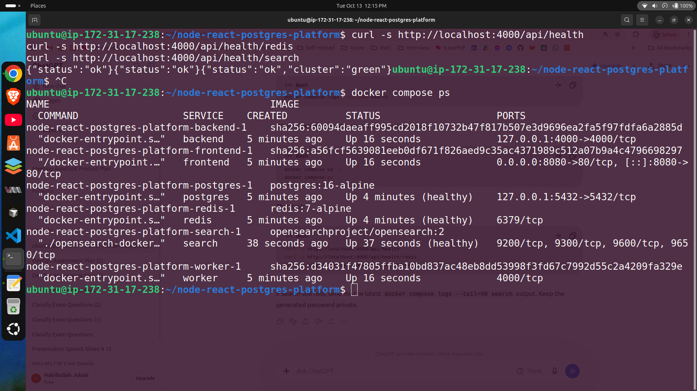
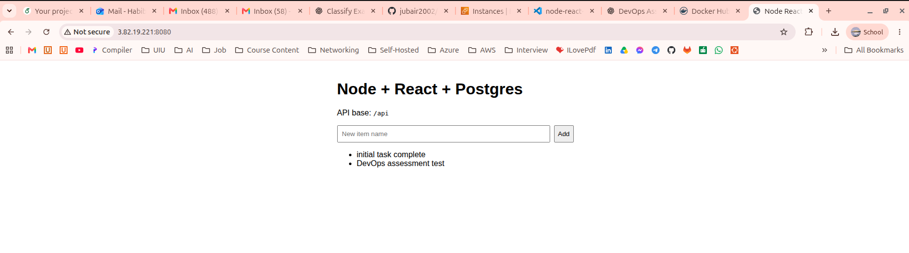

All services are `Up`, and Postgres, Redis and OpenSearch report `(healthy)`. The app on port 8080 reads and writes items through the backend into PostgreSQL.

---

## 3. Task 2 and 3: Kubernetes deployment and Ingress

### Resources (namespace `dev`)

| Component | Kind | Service type | Notes |
|---|---|---|---|
| frontend | Deployment | NodePort `80:30080` | externally reachable |
| backend | Deployment | ClusterIP `4000` | readiness and liveness probes, resource requests/limits |
| postgres | Deployment + PVC | ClusterIP `5432` | persistent storage via PVC |
| redis | Deployment | ClusterIP `6379` | queue backend, internal only |
| search | Deployment (OpenSearch) | ClusterIP `9200` | internal only |
| worker | Deployment (BullMQ) | none | consumes jobs from Redis |

Configuration lives in a ConfigMap, and credentials live in a Secret. Platform services (Postgres, Redis, OpenSearch) are ClusterIP only, so they are never exposed outside the cluster.

**Evidence**

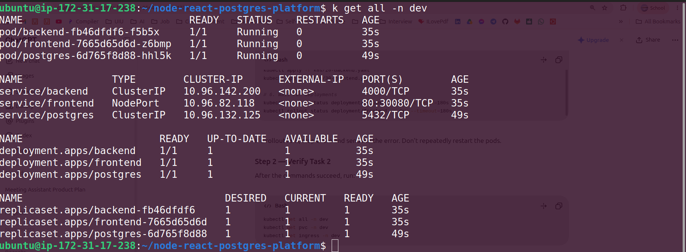


### Ingress (`k8s/40-ingress.yaml`)

Ingress `node-react-ingress` in `dev`, host `node-react.local`:

- `/` goes to the `frontend` Service (port 80).
- `/api` goes to the `backend` Service (port 4000).
- Rate limiting annotations: `limit-rps: "10"`, `limit-burst-multiplier: "2"`.
- Timeouts: proxy connect 30s, proxy read 60s.

**Verification** (using a Host header, so no DNS or hosts-file change is needed):

```bash
curl -i -H 'Host: node-react.local' http://localhost:8081/api/health
# HTTP/1.1 200 OK   {"status":"ok"}
```

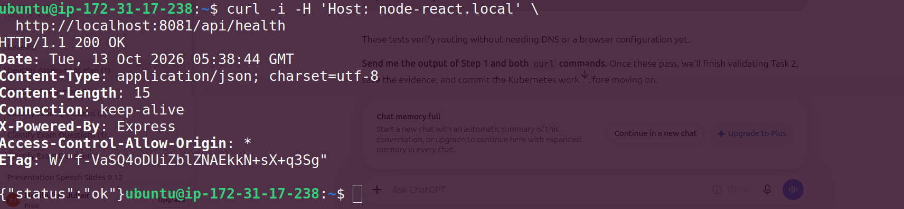

To use a browser, add `<node-ip> node-react.local` to the local hosts file.

### Request path

```
Browser
  → node-react.local (hosts file / DNS)
  → NGINX Ingress Controller (host + path rules, rate limiting)
  → Service (ClusterIP, stable virtual IP, load-balances across pods)
  → Pod (backend container, port 4000)
  → PostgreSQL Service (postgres.dev.svc.cluster.local:5432)
  → PostgreSQL Pod (data on PVC)
```

### How Kubernetes DNS resolves services

CoreDNS gives every Service a name of the form `<service>.<namespace>.svc.cluster.local`. For example, the backend reaches the database at `postgres.dev.svc.cluster.local`, and within the same namespace the short name `postgres` also works because pods get `search dev.svc.cluster.local svc.cluster.local cluster.local` in `/etc/resolv.conf`. The name resolves to the Service ClusterIP, and kube-proxy forwards to a healthy endpoint pod.

### Debugging scenarios

**(a) Ingress is reachable but the backend is not**

1. `kubectl get ingress -n dev` and `kubectl describe ingress node-react-ingress -n dev`: check host, path and backend Service name/port. Look for `<error: endpoints not found>`.
2. `kubectl get endpoints backend -n dev`: empty endpoints mean the Service selector does not match pod labels, or the pods are not Ready.
3. `kubectl get pods -n dev -l app=backend` and `kubectl describe pod`: check readiness probe failures, `Pending` (for example `Insufficient cpu`), or crash loops.
4. `kubectl logs deploy/backend -n dev`: look for application or DB connection errors.
5. `kubectl port-forward svc/backend 4000:4000 -n dev` then `curl localhost:4000/api/health`: tests the Service and pod while bypassing the Ingress.
6. `kubectl logs -n ingress-nginx deploy/ingress-nginx-controller`: look for 502/503/504 and upstream errors.

**(b) The frontend cannot talk to the backend**

1. Open the browser dev tools Network tab: check the request URL, status, and CORS or mixed-content errors. The frontend calls the relative path `/api`, so this must be routed by the Ingress (or proxied by the frontend's NGINX).
2. Confirm the Ingress `/api` rule and that `/` is not shadowing it.
3. From a pod: `kubectl exec -n dev deploy/frontend -- wget -qO- http://backend:4000/api/health` verifies DNS and Service connectivity.
4. `kubectl exec ... -- nslookup backend.dev.svc.cluster.local`: verifies CoreDNS.
5. Check for NetworkPolicies and confirm the Service `targetPort` matches the container port.

### Evolving into microservices

With more backend services, each gets its own Deployment and ClusterIP Service, and the Ingress (or a dedicated API gateway such as Kong, or the Gateway API) routes by path or host: `/api/orders`, `/api/users`, and so on. Cross-cutting concerns (auth, rate limiting, TLS, observability) move into the gateway. Services then communicate asynchronously through the queue, and each service owns its own database.

---

## 4. Task 4: CI/CD (GitHub Actions)

Workflow: `.github/workflows/ci-cd.yml`. Jobs:

| Job | Purpose |
|---|---|
| `build-and-test` | install frontend and backend dependencies, build and run tests/validation |
| `build-and-push` | build Docker images, tag with branch name + short SHA, push to Docker Hub |
| `deploy` | deploy images and manifests to the Kubernetes namespace via the self-hosted runner |
| `rollback` | runs only on failure (skipped on a successful run) |

Branch mapping (per the assessment): `master` → `dev`, `pre-release/v*` → `preprod`, `release/v*` → `release`. In this repository the working branch is `main`, mapped to `dev`.

**Evidence**

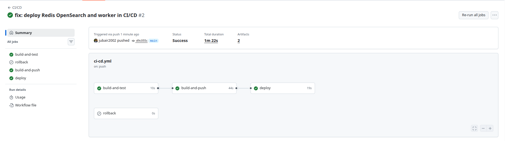

The run "fix: deploy Redis OpenSearch and worker in CI/CD #2" passed in 1m 22s with `build-and-test`, `build-and-push` and `deploy` green. `rollback` was correctly skipped.

### How CI secrets are stored and used

Secrets are stored as encrypted **GitHub Actions repository secrets** and referenced as `${{ secrets.NAME }}`. They are never committed to Git.

| Secret | Use |
|---|---|
| `DOCKERHUB_USERNAME`, `DOCKERHUB_TOKEN` | registry login (an access token, not the account password) |
| `DB_PASSWORD` | PostgreSQL password, injected into the Kubernetes Secret at deploy time |
| `OPENSEARCH_INITIAL_ADMIN_PASSWORD` | OpenSearch admin password, injected the same way |

The self-hosted runner runs on the same host as the kind cluster, so it uses the local kubeconfig and no kubeconfig is stored in GitHub.

### Rollback strategy

- **Fast rollback:** `kubectl rollout undo deployment/backend -n dev` (and `frontend`, `worker`). Check progress with `kubectl rollout status` and `kubectl rollout history`.
- **Pinned rollback:** every image is tagged `<branch>-<short-sha>`, so any previous version can be redeployed with `kubectl set image deployment/backend backend=jubair2002/assesment-backend:<old-tag> -n dev`.
- **Automatic:** the `rollback` job runs when the deploy job fails.

---

## 5. Task 5: Redis, BullMQ worker, OpenSearch

- **Redis** is the backing store for the BullMQ queue.
- **Worker** (`worker` Deployment) consumes background jobs from Redis.
- **OpenSearch** (`search` Service, single node, dev mode) is the search engine. The backend exposes health endpoints for each dependency.
- All three services are ClusterIP only and are never exposed externally.

**Evidence**

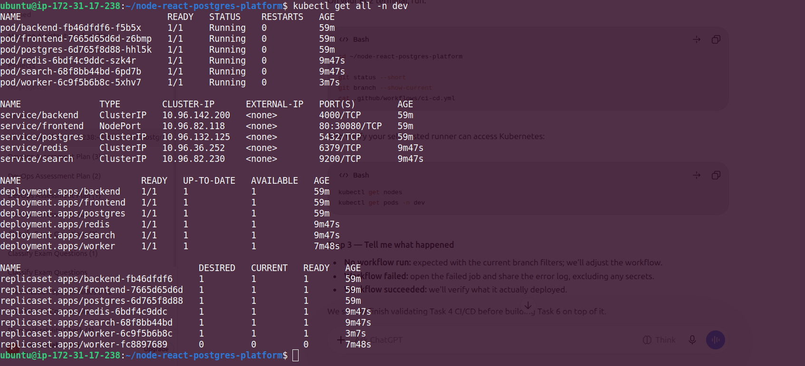


```bash
curl -s http://localhost:4000/api/health          # {"status":"ok"}
curl -s http://localhost:4000/api/health/redis    # {"status":"ok"}
curl -s http://localhost:4000/api/health/search   # {"status":"ok","cluster":"green"}
```

The backend reaches Redis and OpenSearch, and the worker is `1/1 Running`. (The extra `worker` ReplicaSet with 0 replicas is the previous revision left over from a rolling update.)

### Read/write database simulation

The app is configured with separate `DB_WRITE_URL` (primary) and `DB_READ_URL` (replica) environment variables. In this environment both can point to the same PostgreSQL instance; in production they would point to a primary and a streaming replica.

**Where routing logic lives:** in the application's data-access layer, with a write pool and a read pool chosen per query. This is simple and explicit. Alternatives are a DB proxy such as PgBouncer/Pgpool-II/ProxySQL, or a managed endpoint (for example Aurora reader/writer endpoints), which keeps the app unaware but gives less control over per-request consistency.

**Replication lag:** replicas apply changes asynchronously, so a read right after a write can return stale data. Operations that must always hit the writer:

- all writes (INSERT/UPDATE/DELETE) and transactions that mix reads and writes
- read-your-own-writes flows (for example reading an item immediately after creating it)
- authentication, payments and inventory checks, or anything where stale data causes incorrect behavior
- reads inside the same request that just wrote

Lag-tolerant reads (lists, dashboards, search indexing) can use the replica.

---

## 6. Task 6: Observability, scaling and rate limiting

### Metrics (Prometheus + Grafana)

Installed with Helm (`kube-prometheus-stack`) in the `monitoring` namespace, with Metrics Server in `kube-system` for `kubectl top` and HPA.

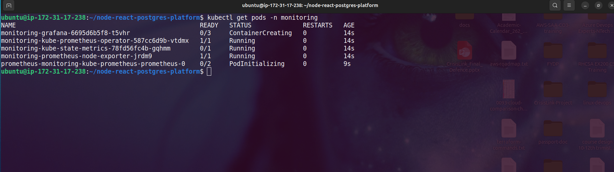
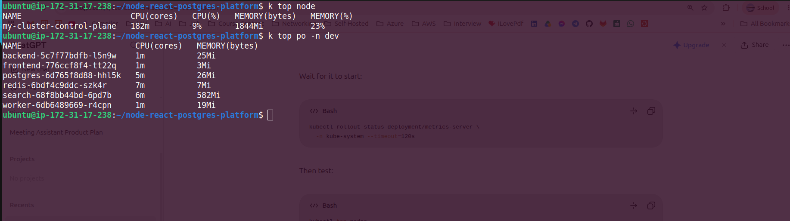
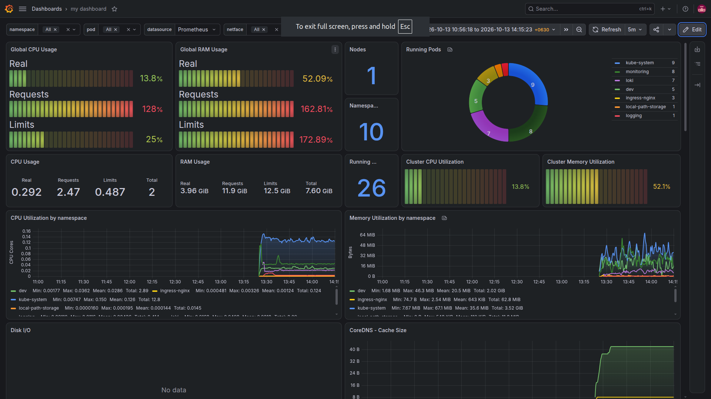

The Grafana dashboard (Prometheus datasource, filterable by namespace and pod) shows cluster CPU and RAM usage versus requests and limits, running pods per namespace (`dev`, `monitoring`, `loki`, `ingress-nginx`, `logging`, `kube-system`), and CPU and memory utilization by namespace over time, including the `dev` namespace where the backend runs. Backend-specific CPU, memory and replica count can be selected with the `namespace` and `pod` filters or the HPA panels. Request rate and error rate come from the NGINX Ingress controller metrics.

### Logging (Fluent Bit + Loki)

Fluent Bit runs as a DaemonSet, collects container logs, and ships them to Loki. Grafana's Explore view queries Loki.

```logql
{job="fluent-bit", namespace="dev"}
```

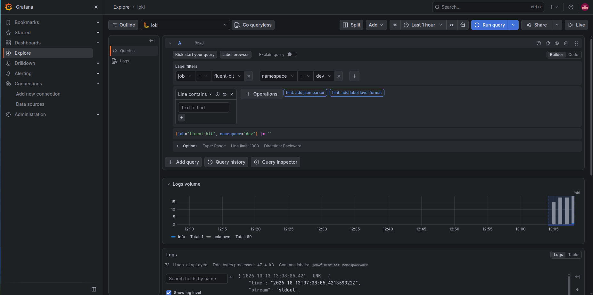

The query returned 73 log lines from the `dev` namespace, which confirms the pipeline. It can be filtered further, for example `{job="fluent-bit", namespace="dev"} |= "error"`.

### Autoscaling (HPA)

Backend HPA: target 70% CPU, min 1, max 3 replicas.

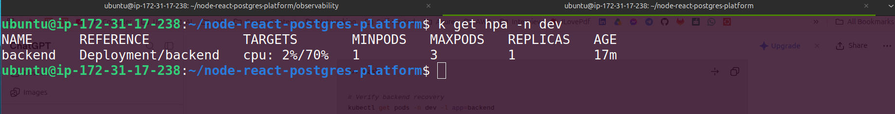

Output: `cpu: 2%/70%`, 1 replica, so the metric is no longer `<unknown>`.

The Pending pod seen while fixing this (after adding resource requests):

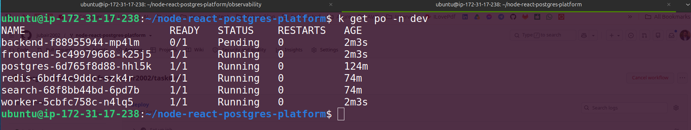

**Issue encountered and fix:** the HPA first showed `<unknown>/70%` because the backend had no CPU requests. After adding requests/limits, the replacement pod stayed `Pending` with `0/1 nodes are available: 1 Insufficient cpu` on the single-node kind cluster. I lowered the requests (`cpu: 50m`, `memory: 64Mi`, limits `300m` / `384Mi`) and the pod became Ready.

### Rate limiting

Applied at the Ingress with NGINX annotations: `limit-rps: "10"` and `limit-burst-multiplier: "2"` (bursts up to 20 requests). 10 requests/second per client IP is generous for a normal user of a CRUD app but blocks scripted abuse, and the burst absorbs page loads that fire several API calls at once. Excess requests receive HTTP 503 by default.

### Metrics I would alert on, and why

| Alert | Why |
|---|---|
| High 5xx error rate (for example >5% for 5 min) | direct user impact; the best signal of a broken release |
| High p95/p99 latency | catches slowdowns before they become errors |
| Backend CPU near the HPA ceiling at max replicas | the autoscaler has no headroom left |
| Pod restarts / CrashLoopBackOff, pods not Ready | failed deploys, OOM kills, probe failures |
| Pods `Pending` (unschedulable) | capacity problems, as seen with `Insufficient cpu` |
| Memory near limit | predicts OOMKills |
| Postgres connection saturation and replication lag | DB bottleneck, stale reads |
| Redis queue depth / failed jobs, worker down | background processing is stuck |
| Node disk and memory pressure, PVC usage | the Postgres volume or node filling up |

---

## 7. Design decisions, trade-offs, and next steps

**Decisions**

- kind on one EC2 host keeps the setup reproducible and local-only, as required.
- BullMQ on Redis reuses Redis rather than adding RabbitMQ, which means fewer moving parts.
- A self-hosted runner lets CI deploy straight into the local kind cluster without exposing the Kubernetes API or storing a kubeconfig in GitHub.
- Loki is lighter than Elasticsearch for a single node and integrates natively with Grafana.
- Platform services stay ClusterIP only, so the attack surface is just the Ingress and the frontend NodePort.

**Trade-offs and limitations**

- A single node means no real HA; resource requests had to be kept small.
- The read/write split is simulated: both URLs point to one database, so replication lag is not actually exercised.
- Secrets are Kubernetes Secrets (base64, not encrypted at rest by default).
- OpenSearch runs single-node in dev mode with minimal security.

**With more time**

- Terraform for the EC2 host and networking, and multi-node kind or a managed cluster (EKS).
- A real PostgreSQL primary/replica setup (for example CloudNativePG or Bitnami HA) and PgBouncer.
- External Secrets / Sealed Secrets or AWS Secrets Manager instead of plain Secrets.
- TLS with cert-manager, NetworkPolicies, and non-root, read-only containers.
- Image scanning (Trivy) in CI, and progressive delivery (canary / Argo Rollouts) or GitOps with Argo CD.
- Alertmanager routing, SLO-based alerts, and distributed tracing (OpenTelemetry).
- Load testing to validate the HPA scale-up and the rate-limit thresholds.
